# Metro-WM: Long-Horizon Latent Planning with Realisable Sub-Goals

<p align="center">
  <a href="https://arxiv.org/abs/2609.31868">Paper (arXiv:2609.31868)</a> | <a href="#getting-started">Getting started</a> | <a href="#citation">Citation</a>
</p>

Metro-WM is a training-free hierarchical planner for JEPA world models. Instead of generating latent sub-goals, which are often physically unrealisable, it retrieves real frames from offline data as sub-goals. It does this by routing over a graph of recorded frames that stitches episodes together.

## News

- **18 Oct 2026**: Added [comparisons with H-JEPA and HWM](#comparisons-with-h-jepa-and-hwm-gradient-planner) in their evaluation setup. We will update the paper soon.
- **16 Oct 2026**: Code released.
- **25 Sep 2026**: Paper released on [arXiv](https://arxiv.org/abs/2609.31868).

## Results

### Comparisons with H-JEPA and HWM (Gradient planner)

In the setup of [H-JEPA](https://github.com/kevinghst/H-JEPA) (their checkpoints, gradient-descent planner, tasks and evaluation code), Metro-WM guides their flat LeWM and achieves the highest mean success on all four benchmarks. Mean ± standard deviation over H-JEPA's model seeds 42/43/44.
To reproduce, see the [H-JEPA setup](docs/hjepa_setup.md).

<p align="center">
  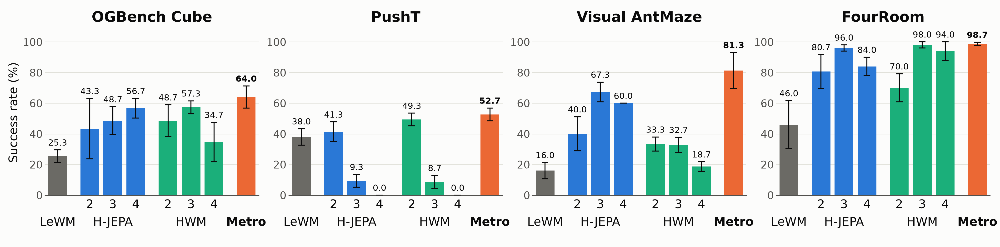
</p>

<p align="center">
  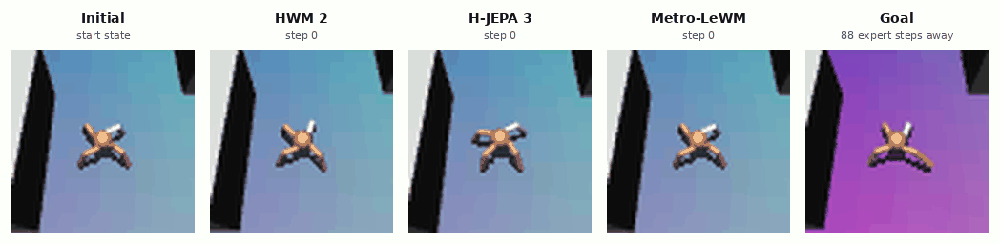
</p>

<details>
<summary>More examples</summary>

<p align="center">
  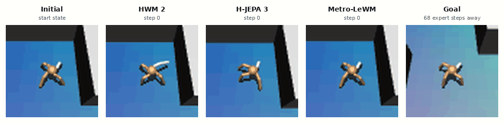
  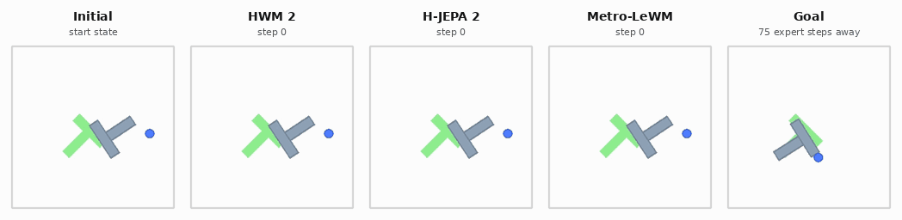
  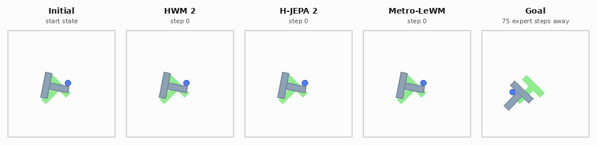
  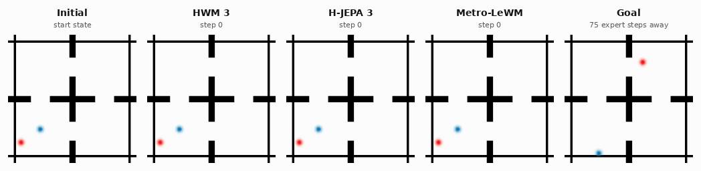
  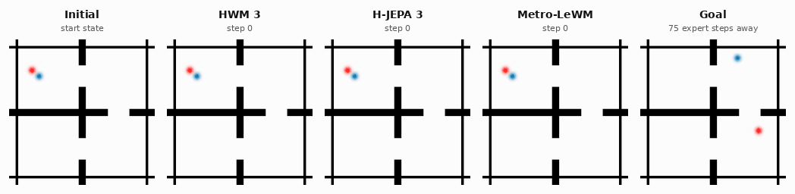
</p>

</details>


### Comparisons with Hi-LeWM and Hi-LeWM-C (CEM planner)

In the setup of [LeWM](https://github.com/lucas-maes/le-wm), Metro-WM guides LeWM's CEM planner and beats flat LeWM and the three hierarchical [Hi-LeWM](https://arxiv.org/abs/2607.12547) baselines on all four benchmarks.
Success at goal distance 75 frames, mean ± standard deviation over 3 planner seeds 7/8/9.
To reproduce, see the [LeWM setup](docs/lewm_setup.md).

<p align="center">
  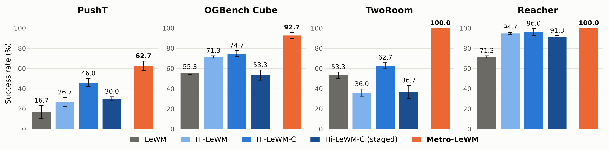
</p>

<p align="center">
  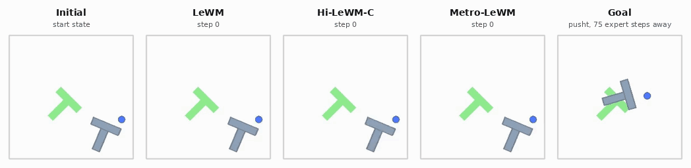
</p>

<details>
<summary>More examples</summary>

<p align="center">
  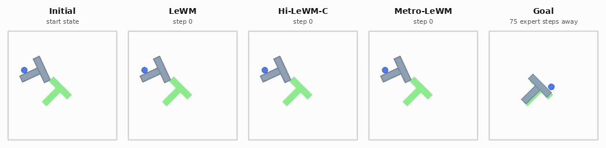
  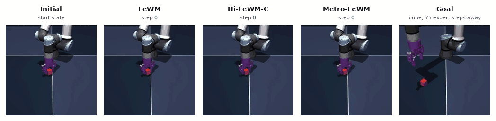
  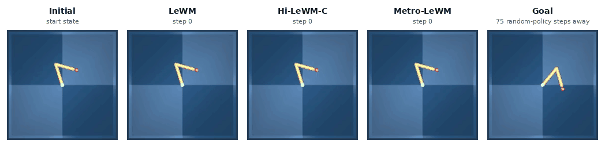
  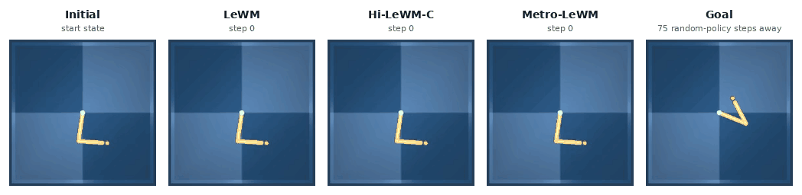
  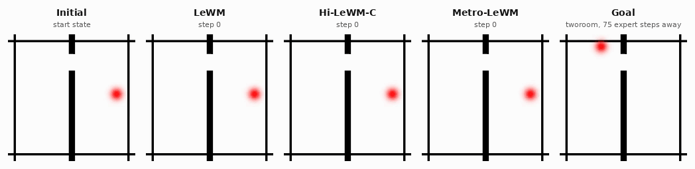
  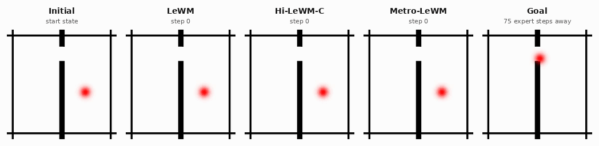
</p>

</details>


## Getting started

Each setup has its own standalone guide covering installation, data and models, building the graph and running Metro-WM.

| Setup | Planner | Benchmarks | Guide |
|---|---|---|---|
| H-JEPA | Gradient descent | Cube, PushT, AntMaze, FourRoom | [docs/hjepa_setup.md](docs/hjepa_setup.md) |
| LeWM | CEM | PushT, Cube, TwoRoom, Reacher | [docs/lewm_setup.md](docs/lewm_setup.md) |

## Method

<details>
<summary>Abstract</summary>

Model-predictive control with Joint-Embedding Predictive Architectures (JEPAs) provides a strong zero-shot goal-reaching planner, but it is only effective over short planning horizons. Hierarchical extensions attempt to bridge this gap by learning a macro planner to predict intermediate latent sub-goals to guide the micro planner. In this work, we demonstrate that unconstrained latent sub-goal prediction is fundamentally flawed. A rigorous evaluation reveals that leading hierarchical macro
planners routinely emit physically unrealisable sub-goals. To resolve this, we introduce Metro-WM, a hierarchical framework that issues sub-goals by retrieving genuine states from prior experience rather than generating ungrounded latent vectors. Specifically, Metro-WM constructs a graph whose vertices are observed frames from offline expert demonstrations or random-action trajectories, allowing frames from different episodes to be connected and stitched into routes to the goal. Planning over the full graph also makes the system highly robust to execution errors: if the micro planner drifts off course, Metro-WM instantly finds a new optimal path from the current state. Our experiments show that Metro-WM achieves superior long-horizon success rates of up to 37.33 percentage points over the strongest hierarchical baseline on the same world model while being up to 10.9 times faster, requiring both 13-56 times less offline compute and fewer tuned hyperparameters. Additional analysis reveals that Metro-WM frequently finds shorter paths than the offline demonstrations, outperforms an oracle relying on the query's own demonstration on most benchmarks, and maintains robust performance under extremely sparse dataset conditions.

</details>

<p align="center">
  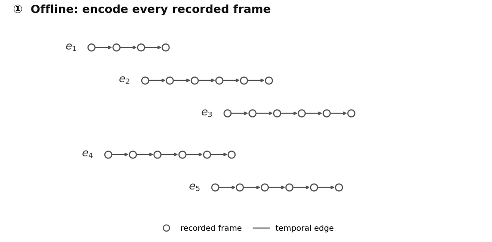
</p>

Every recorded frame is a vertex. Directed temporal edges (solid grey) connect consecutive frames within each episode, while symmetric bridge edges (dashed grey) link visually similar frames across episodes. Metro-WM routes over this map from the current observation to the goal and hands the micro planner the farthest vertex within reach.

What a bridge looks like in pixels: when a route crosses one, it leaves a demonstration (blue) and continues along another (red).

<p align="center">
  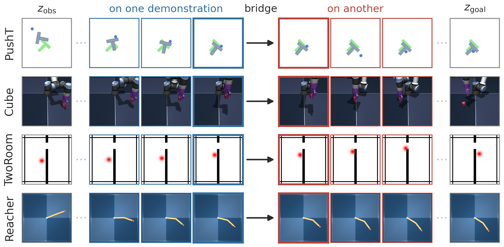
</p>

## Citation

```bibtex
@misc{lee2026metrowm,
      title={Metro-WM: Long-Horizon Latent Planning with Realisable Sub-Goals},
      author={Royson Lee and Fady Rezk and Titouan Parcollet and Timothy Hospedales and Cristina Cornelio},
      year={2026},
      eprint={2609.31868},
      archivePrefix={arXiv},
      primaryClass={cs.AI},
      url={https://arxiv.org/abs/2609.31868},
}
```

## Credits

This codebase is built on top of [LeWorldModel](https://github.com/lucas-maes/le-wm) and [stable-worldmodel](https://github.com/galilai-group/stable-worldmodel); the [H-JEPA setup](docs/hjepa_setup.md) runs inside [H-JEPA](https://github.com/kevinghst/H-JEPA). All three are MIT licensed. For further information, see `NOTICE` and `LICENSES/`.
